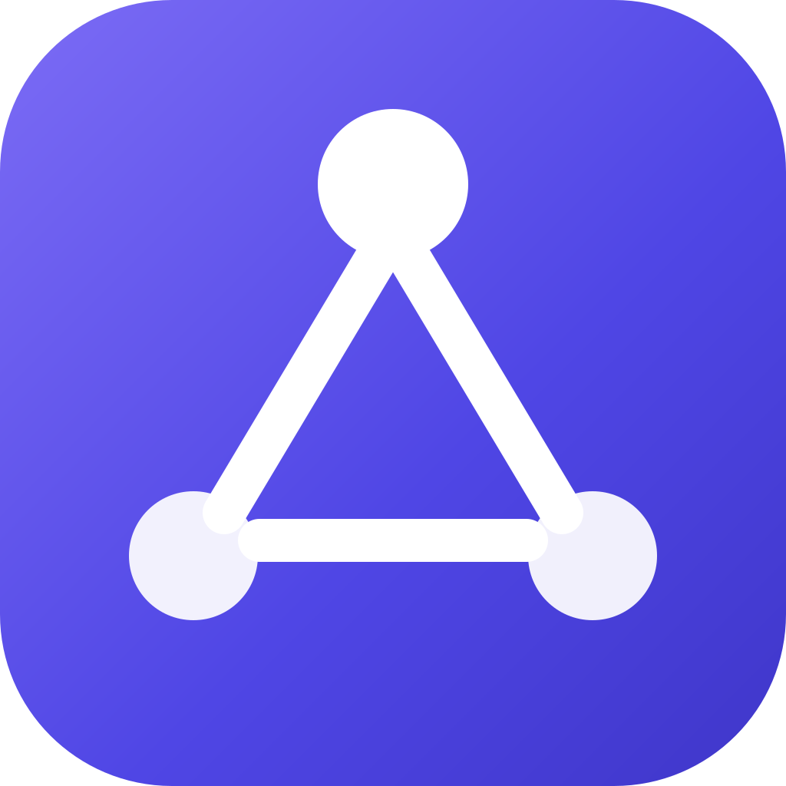

<div align="center">



# AgentLab

**Build agents. Build their ontologies. Self-hosted.**

[English](README.md) | [简体中文](README.zh-CN.md)

[](LICENSE)


</div>

**AgentLab** is a **personal work & learning assistant for knowledge-intensive professionals** (engineers, teachers, compliance officers, researchers, clinicians) — fully deployable on one machine. Its thesis: your knowledge should not be a pile of documents, but a **structured asset you can query, audit and quiz against** — an ontology. Built with Go (CloudWeGo Eino/ADK), React and SQLite, it is organized around two cores:

- **Agent engineering** — a conversational agent workbench with fully observable execution, multi-agent collaboration, and knowledge / skill / ontology augmentation.
- **Ontology engineering** — a full ontology (knowledge-graph) lifecycle: build → asset management → runtime engines → consumption & audit.

Self-hosted — data, keys and knowledge stay under your control: data lives in a local SQLite database, model API keys are AES-256-GCM encrypted on disk, and the only external dependency is the LLM provider(s) you configure.

## Contents

- [✨ Key Features](#-key-features)
- [🧭 Explore](#-explore)
- [🚀 Quick Start](#-quick-start)
- [💻 Development Mode](#-development-mode-frontend-hot-reload)
- [🧱 Tech Stack](#-tech-stack)
- [🗂 Repository Layout](#-repository-layout)
- [📚 Documentation](#-documentation)
- [🧭 Roadmap](#-roadmap)
- [🙏 Open Source & Papers](#-open-source--papers)
- [❓ FAQ](#-faq)
- [🤝 Contributing](#-contributing)
- [📜 License](#-license)

## ✨ Key Features

- **Fully observable execution** — tool calls, thinking, sub-agent delegation, knowledge recall and ontology queries appear as color-coded event cards; export & replay make every answer accountable.
- **Multi-agent collaboration** — Agent-as-Tool / Transfer orchestration with a visible delegation timeline; a 2–4-pane comparison mode runs one question under different configurations side by side.
- **Ontology as the knowledge backbone** — build → assets → runtime → consumption & audit; answers trace back to structured knowledge, not text scraps.
- **AI-assisted building behind quality gates** — six build paths (manual, OntoChat conversational authoring, CQ-driven evolution, build-from-KB, CSV, import/merge); LLM output enters the library only after scoring and self-repair.
- **CQ regression baselines** — competency questions become re-runnable test assets: coverage quantification plus an answerability pre-check (`check_answerable`).
- **RAG + GraphRAG knowledge bases** — vector retrieval plus a self-contained KG backend (graph browsing / multi-hop / community QA); a companion ontology grows with every conversation.
- **Open by protocol** — every agent is itself an MCP server; MCP + A2A connect external agents; execution backends are pluggable (in-process / Docker / Kubernetes).
- **Single-machine & desktop** — one command to start, zero Python runtime dependency; Windows / macOS installers; data, keys and ontologies never leave the machine.

Each point unfolds below in [Explore](#-explore); module-level guides live in [platform-knowledge/](platform-knowledge/README.md).

## 🧭 Explore

<details>
<summary><b>🔍 Agent engineering — a fully observable conversation workbench</b></summary>

### Agent engineering: a fully observable conversation workbench

- **Every step of execution is visible** — on top of SSE streaming replies, tool calls, deep thinking, sub-agent delegation, knowledge recall and ontology queries appear as color-coded event cards; expandable JSON, raw-event debugging, export & replay — every answer is accountable.
- **Multi-agent collaboration** — projects orchestrate multiple agents (Agent-as-Tool / Transfer) with a visible delegation timeline; a 2–4 pane comparison mode runs the same question under different configurations (model / knowledge base / ontology / skill / temperature / prompt override) side by side.
- **Knowledge · skill · ontology augmentation** — document upload → chunking → embedding → retrieval, with a GraphRAG sub-module covering graph browsing, multi-hop retrieval and community-summary QA; skill packs inject with preview and per-session toggles; the **companion ontology** extracts knowledge candidates after each conversation and merges confirmed entries into the graph and retrieval sources — the agent grows to understand your domain.
- **Open integration** — every agent is itself an MCP server (the `/mcp` endpoint): any MCP client (Claude Desktop, Cursor, …) can connect and chat; execution backends are pluggable behind one interface: in-process assembly (default) / Docker sandbox (one container per agent) / Kubernetes Pod.

</details>

<details>
<summary><b>🕸 Ontology engineering — a full lifecycle from build to audit</b></summary>

### Ontology engineering: a full lifecycle from build to audit

- **Multiple build paths, AI output must pass the quality gate** — manual modeling, OntoChat guided authoring, CQ-driven evolution, build-from-knowledge-base, CSV import and more; LLM-generated content enters the library only after quality-gate scoring and self-repair.
- **Paper-grade methods, internalized** — OntoChat's four steps (CQ extraction → purification → analysis → testing) and OntoExtend's three-stage pipeline (retrieve → generate → integrate) are implemented per the papers and regression-tested; **competency questions (CQs) graduate from one-off artifacts to re-runnable regression baselines** — a session-level test station, dual-track quick screening + SPARQL fine judgement, and three-level coverage quantification on the term / property layers.
- **Multi-form asset management** — version snapshots & diff, source view, SPARQL workbench, 3D force-directed graph + WebVOWL semantic view, import/merge review wizard, publish state machine; lossy imports are reported honestly.
- **Runtime plane** — Oxigraph / Fuseki engine profiles (with an OWL reasoning switch), one-click engine install, a load-reconciliation hard gate (source/engine triple counts compared, mismatch aborts startup), and per-graph isolation for multi-ontology profiles.
- **Consumption & audit** — a KG retrieval observatory over TTL / text sources plus a full decision audit trail — the ontology is not just a modeling artifact but a consumable, accountable runtime asset.

</details>

<details>
<summary><b>🛠 Engineering & product form</b></summary>

### Engineering & product form

- **Single-machine deployable, all local** — one command to start (`run-dev.sh`), no Python runtime dependency; data, keys, knowledge and ontologies never leave the machine.
- **Desktop clients** — Windows / macOS installers (Tauri 2 shell): system tray, single instance, whole-process-tree teardown, one-click install for engines and the sidecar on first launch.
- **Platform knowledge shipped in-app** — product design, technical principles, module guides and research notes render in place; capability boundaries are honestly labeled (e.g. KG-augmented retrieval is a lightweight implementation).
- **Quality assets maintained in-repo** — a regression smoke-test checklist plus headless UI smoke suites, so every delivery round is verifiable and replayable.

</details>

## 🚀 Quick Start

### Run from source

Linux / macOS:

```bash
./run-dev.sh          # Windows: .\run-dev.ps1
# open http://localhost:8080
```

First launch automatically initializes the SQLite database (`backend/data/platform.db`) and creates a preset DeepSeek model connection.

### Configure a model (required)

Open **Settings → Model Management**, edit **DeepSeek (preset)**, fill in your API key and click **Test Connection** — or add any OpenAI-compatible / Anthropic-compatible connection (custom base_url + model). Keys are stored locally only, never uploaded.

### Desktop installers

The shell starts the local services and opens the platform window:

- Windows — see [deploy/windows/README.md](deploy/windows/README.md)
- macOS — see [deploy/macos/README.md](deploy/macos/README.md)

For Docker Compose, Helm and environment variables, see the [deployment guide](platform-knowledge/01_整体设计/16_部署与运行.md).

## 💻 Development Mode (frontend hot reload)

```bash
cd backend && go run ./cmd/backend   # terminal 1 (:8080)
cd web && npm run dev               # terminal 2 (:5173, proxies API to :8080)
```

## 🧱 Tech Stack

| Layer | Choices |
| --- | --- |
| Backend | Go 1.22+ · CloudWeGo Eino/ADK · mark3labs/mcp-go · SQLite (optional Qdrant vector store) |
| Frontend | React 18 · TypeScript · Vite · Ant Design 6 · Ant Design X · zustand · 3d-force-graph |
| Protocols | REST + SSE (streaming) · MCP (both consuming and serving) |

## 🗂 Repository Layout

```
backend/             Go main platform backend (:8080, also hosts the web UI)
ontology-service/    Ontology build plane (:8091, multi-form assets / quality gate)
runtime-manager/     Ontology runtime plane (:8090, engine profile management)
web/                 React 18 + Vite + TS frontend
apps/desktop/        Desktop client (Tauri shell frontend, Windows / macOS)
website/             Project website (GitHub Pages; auto-deploys on push to main)
platform-knowledge/  In-app platform knowledge (product design / principles / module guides)
docs/                Requirements & design documents (source of truth, see index below)
seeds/learning/      Single source for skill packs & sample ontology content
deploy/              Docker Compose + Helm + desktop build scripts
tools/ research/ smoke/   Utilities, research notes, smoke-test suites
```

## 📚 Documentation

| Document | Content |
| --- | --- |
| [docs/01_智能体_需求文档_PRD.md](docs/01_智能体_需求文档_PRD.md) | Agent requirements (REQ registry + iteration log) |
| [docs/02_智能体_技术方案设计.md](docs/02_智能体_技术方案设计.md) | Technical design (architecture / API / SSE protocol / §12 milestone status) |
| [docs/03_本体_需求文档.md](docs/03_本体_需求文档.md) · [docs/04_本体_方案设计.md](docs/04_本体_方案设计.md) | Ontology module requirements & design |
| [docs/11_知识库_需求文档.md](docs/11_知识库_需求文档.md) · [docs/12_知识库_方案设计.md](docs/12_知识库_方案设计.md) | Knowledge-base module requirements & design |
| [docs/15_开源项目及论文登记簿.md](docs/15_开源项目及论文登记簿.md) | Open-source projects & papers registry (global ledger of every external reference) |
| [docs/18_REQ编号注册表.md](docs/18_REQ编号注册表.md) | REQ number allocation authority |
| [docs/20_回归冒烟清单.md](docs/20_回归冒烟清单.md) | Regression smoke-test checklist |
| [platform-knowledge/](platform-knowledge/README.md) | Module guides (product design / principles / research, per module) |
| [platform-knowledge/01_整体设计/17_产品_信息架构与界面设计.md](platform-knowledge/01_整体设计/17_产品_信息架构与界面设计.md) | UI / information-architecture source of truth |
| [platform-knowledge/02_智能体/27_外部MCP客户端直连验证包.md](platform-knowledge/02_智能体/27_外部MCP客户端直连验证包.md) | Connecting Claude Desktop / Cursor |
| [AGENTS.md](AGENTS.md) | Guide for AI coding assistants |

A directional overview follows in [Roadmap](#-roadmap); requirement status details live in **docs/02 §12** and **docs/18** — they are intentionally not duplicated here.

## 🧭 Roadmap

The project has grown from a teaching demo into a **production-grade, single-machine deployable product**: desktop installers on both platforms, a quality gate and regression smoke-test system in place. Positioning now anchors on a **personal work & learning assistant grounded on ontologies** (Q-23, 2026-10-28). Work continues along the two cores plus the assistant product surface; the directions below are an overview (authoritative requirement rows, priorities and delivery status live in docs/02 §12 and docs/18; some items are trigger-driven):

| Direction | Evolution |
| --- | --- |
| **Ontology trust & zero-loss** | Zero-loss reconciliation across import / runtime / export: import normalization with a capture-rate sentinel, a full remainder ledger for unprojected triples, and direct-mount of unedited imports at runtime (approved); change impact analysis, bi-temporal versioning, deterministic identity keys and evidence grading of build outputs (approved, trigger-driven) |
| **Ontology quality assessment** | CQ regression baselines are live (session-level test station, dual-track screening + SPARQL fine judgement, coverage quantification); the next step is **asset-level layered assessment** — borrowing CQ4OE's multi-dimensional metrics over terms / properties / axioms / hierarchy / CQ coverage |
| **KG & retrieval augmentation** | Community detection upgrade (Louvain) and multi-hop evidence collection; a "pre-filter → ranking" hybrid retrieval shape; temporal dimensions for the companion ontology and deeper agent memory |
| **Agent runtime** | Long-running tasks across sessions with cost guards; workflow orchestration (sequential / parallel / loop, trigger-driven); sandbox hardening (gVisor / Kata isolation options, Kubernetes scheduling) |
| **Delivery & ecosystem** | Continued desktop polish (CI packaging, auto-update, etc.); a growing MCP facade tool surface; an expanding authority-ontology catalog and online vocabulary lookup |
| **Personal knowledge loop & product surface** | A unified assistant entry (with the workspace rename folded in) as the daily surface; the **Notes** module (REQ-495) as a self-produced document asset layer — cited back into knowledge bases and distilled into ontologies; a quiz · grading · mastery loop grounded in ontologies; cross-session memory and near-zero-effort cold-start modeling — all backlog items, trigger-driven ([docs/01 §9](docs/01_智能体_需求文档_PRD.md)) |

## 🙏 Appreciation

AgentLab stands on the shoulders of the open-source community and academic work — direct dependencies are used under their own licenses; methodological borrowings follow the principle of **borrowing ideas, implementing ourselves**. The lists below are grouped by this project's **architecture layers** (direct use) and by **domain** (key references); the full ledger (with requirement links, evaluation notes and rejected candidates) lives in [docs/15_开源项目及论文登记簿.md](docs/15_开源项目及论文登记簿.md).

### Directly used — by architecture layer

**Agent engine (Go backend)**

| Project | License | Role |
| --- | --- | --- |
| [CloudWeGo Eino / Eino ADK](https://github.com/cloudwego/eino) | Apache-2.0 | Agent orchestration backbone: ReAct agents, multi-agent (Agent-as-Tool / Transfer), streaming chat |
| [CloudWeGo Hertz](https://github.com/cloudwego/hertz) | Apache-2.0 | HTTP framework: REST API, SSE streaming, static hosting of the web UI |
| [eino-ext](https://github.com/cloudwego/eino-ext) | Apache-2.0 | Eino ecosystem components: OpenAI / Claude model channels, embeddings, MCP tool consumption |
| [mark3labs/mcp-go](https://github.com/mark3labs/mcp-go) | MIT | MCP serving foundation: the agent `/mcp` endpoint and the ontology `onto_*` facade |
| [modernc.org/sqlite](https://gitlab.com/cznic/sqlite) | MIT | Pure-Go SQLite driver (no CGO, zero external dependencies) |
| [santhosh-tekuri/jsonschema](https://github.com/santhosh-tekuri/jsonschema) | MIT | spec_json structural validation |
| [gonum](https://github.com/gonum/gonum) | BSD-3 | Planned: KG community detection (Louvain) |

**Ontology plane (build & runtime)**

| Project | License | Role |
| --- | --- | --- |
| [rdflib](https://github.com/RDFLib/rdflib) | BSD-3 | Python sidecar (`tools/rdf-sidecar`): OWL/RDF parsing, TTL export and read-back validation |
| [pySHACL](https://github.com/RDFLib/pySHACL) | Apache-2.0 | SHACL constraint validation (optional sidecar component, business-constraint layer of the quality gate) |
| [Oxigraph](https://github.com/oxigraph/oxigraph) | MIT / Apache-2.0 | Default SPARQL 1.1 store (single binary, managed by the runtime plane) |
| [Apache Jena Fuseki](https://github.com/apache/jena) | Apache-2.0 | SPARQL service with an OWL reasoning switch (optional runtime engine) |

**Frontend (React)**

| Project | License | Role |
| --- | --- | --- |
| [Ant Design](https://github.com/ant-design/ant-design) · [Ant Design X](https://github.com/ant-design/x) | MIT | UI component library and AI chat components |
| [ReactFlow](https://github.com/xyflow/xyflow) | MIT | Ontology structure view canvas (renders spec_json directly) |
| [3d-force-graph](https://github.com/vasturiano/3d-force-graph) · [react-force-graph-3d](https://github.com/vasturiano/react-force-graph-3d) | MIT | 3D force-directed ontology browsing |
| [WebVOWL](https://github.com/VisualDataWeb/WebVOWL) | MIT | Standard TBox visualization (comparison view) |
| [CodeMirror 6](https://github.com/codemirror/dev) ([@uiw/react-codemirror](https://github.com/uiwjs/react-codemirror)) | MIT | spec / JSON / SPARQL editors (highlighting, inline lint, text diff) |
| [react-diff-viewer-continued](https://github.com/afzalsayed96/react-diff-viewer-continued) | MIT | Side-by-side version diff |

**Desktop & delivery**

| Project | License | Role |
| --- | --- | --- |
| [Tauri 2](https://github.com/tauri-apps/tauri) | MIT / Apache-2.0 | Windows / macOS desktop shell (system tray, single instance) |

### Key references (ideas borrowed, implemented in-house)

**Ontology methodology & toolchain**（含引导使用 guided execution paths——平台外使用、产物回流）

| Project / source | Links | What was borrowed / role |
| --- | --- | --- |
| **OntoChat** | [GitHub](https://github.com/King-s-Knowledge-Graph-Lab/OntoChat) · [paper](https://arxiv.org/abs/2403.05921) | Blueprint for the conversational ontology path: user story → CQ → clustering → testing workflow plus prompt templates; CQ extraction / purification / analysis implemented step-by-step per the paper, with the coverage test station shipped as a CQ regression baseline |
| **OntoExtend** | [GitHub](https://github.com/dersuchendee/OntoExtend) · [paper](https://arxiv.org/abs/2607.17963) | The three-stage CQ-driven extension pipeline (Retriever → Extender → Integrator) and its retrieval recipe (element-level serialization + sentence-embedding top-k); implemented as the CQ-driven evolution path |
| **CQ4OE**（OEG-UPM） | [GitHub](https://github.com/oeg-upm/cq4oe-benchmark) · [paper](https://arxiv.org/abs/2609.26029) | Benchmark methodology for LLM ontology generation: three-level CQ coverage metrics and the multi-method term-alignment pipeline — the blueprint for asset-level layered quality assessment |
| OWLAPY | [GitHub](https://github.com/dice-group/owlapy) | Python LLM ontology framework: generate-validate loop and prompt design reference |
| Protégé / WebProtégé（guided） | [Protégé](https://github.com/protegeproject/protege) · [WebProtégé](https://github.com/protegeproject/webprotege)（BSD / Apache-2.0） | Industry-standard ontology editors (desktop / collaborative web); OWL/TTL exports import back via guided execution paths |
| ROBOT（guided） | [GitHub](https://github.com/ontodev/robot)（Apache-2.0） | CLI ontology processing: template batch generation / merge / subset |
| OOPS!（guided） | [oops.linkeddata.es](https://oops.linkeddata.es)（Apache-2.0） | Ontology pitfall scanning (34 common error classes); a reference dimension of the quality gate |
| ELK / HermiT（guided） | [ELK](https://github.com/liveontologies/elk-reasoner) · [HermiT](https://github.com/phillord/hermit-reasoner)（LGPL） | OWL reasoners (ELK fast / HermiT complete) for logical-consistency checks |

**Knowledge systems & retrieval**

| Project / source | Links | What was borrowed |
| --- | --- | --- |
| ontology-on-snowflake（Snowflake-Labs） | [GitHub](https://github.com/Snowflake-Labs/ontology-on-snowflake) | Flattened GraphRAG concept-profile precomputation — the direct basis of the companion retrieval "concept profile unit"; its benchmark data and profile-doc structure informed the design |
| HelixDB · Helix Foundry | [helix-db](https://github.com/HelixDB/helix-db) · [helix-foundry](https://github.com/HelixDB/helix-foundry) | The "pre-filter → ranking" hybrid retrieval shape, base+overlay+audit layering and evidence grading (engine not adopted — non-RDF ecosystem, conflicts with the spec→TTL→SPARQL mainline) |
| semantica | [GitHub](https://github.com/semantica-agi/semantica) | Three-layer architecture, GraphRAG hybrid retrieval ideas and the PROV-O decision-provenance narrative — the reference sample behind our lightweight in-house consumption & audit plane (no runtime integration) |
| Open Ontologies | [GitHub](https://github.com/fabio-rovai/open-ontologies) | Deep study of judgement discipline, lifecycle governance (plan / apply / drift) and bi-temporal mechanics, distilled into research notes and an in-house adoption list (dual-track integration retired) |
| OpenBKN | [GitHub](https://github.com/openbkn-ai/bkn-foundry) | Enterprise ontology platform (Palantir Foundry counterpart) as design reference: knowledge packaging, ontology retrieval, managed evolution steps |
| Graphiti / Zep | [GitHub](https://github.com/getzep/graphiti) | The reference standard for agent temporal knowledge-graph memory: time-aware edges, incremental evolution, hybrid retrieval — informs the companion ontology roadmap |
| LangChain / LlamaIndex | [LangChain](https://github.com/langchain-ai/langchain) · [LlamaIndex](https://github.com/run-llama/llama_index) | Cross-ecosystem check: external MCP clients consuming the same facade to validate open integration |

**Product & learning-space references**

| Project / source | Links | What was borrowed |
| --- | --- | --- |
| **DeepTutor**（HKUDS） | [GitHub](https://github.com/HKUDS/DeepTutor) · [paper](https://arxiv.org/abs/2604.26962) | Agent-native personal learning workspace (40k★/9 months) — product-narrative reference and the direct input to the Q-23 positioning: scene sharpness beats engine generality; its learning loop (quiz · grading · mastery) is borrowed while differentiation comes from **ontology-grounded** coverage guarantees and concept-graph mastery (vs pure LLM quiz generation); cold-start modeling cost is the make-or-break. Full analysis: [调研档 91 号](platform-knowledge/01_整体设计/91_DeepTutor对标分析_个人学习助手赛道_20261029.md) |
| Microsoft Ontology-Playground | [GitHub](https://github.com/microsoft/Ontology-Playground) | A same-position ontology learning site: progressive domain paths, sample catalogs and gamification as learning-center design references |

### Papers & standards

<details>
<summary><b>Papers & standards</b></summary>

| OntoChat: a Framework for Conversational Ontology Engineering using Language Models (ESWC 2024) | [arXiv 2403.05921](https://arxiv.org/abs/2403.05921) | The four-step conversational OE workflow (user story → CQ → clustering → testing) and practitioner survey |
| Improving Ontology Requirements Engineering with OntoChat and Participatory Prompting | [arXiv 2408.15256](https://arxiv.org/abs/2408.15256) | The participatory prompting protocol (user-story guidance) |
| OntoChat Assistant for User Story Generation in Ontology Engineering | [ACM DL 10.1145/3810943](https://doi.org/10.1145/3810943) | A design-validated prompting framework for user-story generation |
| OntoExtend: A Framework for Requirement-driven and Scalable Ontology Extension with LLMs | [arXiv 2607.17963](https://arxiv.org/abs/2607.17963) | The requirement-driven three-stage pipeline, retrieval experiments and triple evaluation |
| Ontology extension by online clustering with LLM agents (Frontiers in Big Data 2024) | [DOI 10.3389/fdata.2024.1463543](https://doi.org/10.3389/fdata.2024.1463543) | Zero-shot streaming ontology extension route |
| CQ4OE: A Benchmark for Assessing LLM-assisted Ontology Generation | [arXiv 2609.26029](https://arxiv.org/abs/2609.26029) | CQ-alignment benchmark: multi-dimensional metrics and three-level CQ coverage |
| MASEO: Multi-Agent System for Explainable Ontology Generation (LLMs4KG 2026) | [PDF](https://dgarijo.com/papers/maseo-camera-ready.pdf) | Four-stage multi-agent generation pipeline (generate → syntax → consistency → pitfalls), a reference for build-pipeline orchestration |
| LLMs for Ontology Engineering: A Systematic Literature Review (Semantic Web Journal) | [DOI 10.1177/22104968261465514](https://doi.org/10.1177/22104968261465514) | Survey of the three LLM roles (engineer / expert / evaluator) |
| IDEA2: Expert-in-the-loop Competency Question Elicitation | [arXiv 2604.01344](https://arxiv.org/abs/2604.01344) | Semi-automatic CQ elicitation workflow with provenance tracking |
| NeOn Methodology (Suárez-Figueroa et al., Springer 2012) | —— | Scenario-based ontology lifecycle methodology; one source of our seven-stage build model |
| Ontology Development 101 (Noy & McGuinness, 2001) | [Stanford](https://protege.stanford.edu/publications/ontology_development/ontology101.pdf) | The classic modeling primer; baseline textbook of the learning content pack |
| Gruninger & Fox: The Design and Evaluation of Ontologies (TOVE, 1995) | —— | Original source of the competency-question methodology |
| ReAct: Synergizing Reasoning and Acting in Language Models | [arXiv 2210.03629](https://arxiv.org/abs/2210.03629) | The reasoning-acting interleaved paradigm (engineering paradigm behind the Eino ADK agent mode) |
| From Local to Global: A Graph RAG Approach to Query-Focused Summarization (Microsoft Research) | [arXiv 2404.16130](https://arxiv.org/abs/2404.16130) | Theoretical source of GraphRAG: community summaries + query-focused summarization |
| LLM Wiki: a pattern for building personal knowledge bases using LLMs (A. Karpathy) | [Gist](https://gist.github.com/karpathy/442a6bf555914893e9891c11519de94f) | The "compile knowledge at write time, keep it fresh" pattern — a reference for the write-time accumulation route of the knowledge base and companion ontology |
| Model Context Protocol (MCP) specification | [modelcontextprotocol.io](https://modelcontextprotocol.io) | The integration protocol across the platform: tool consumption plus agent / ontology facade serving |
| RDF 1.1 / OWL 2 / SHACL / SPARQL 1.1 / PROV-O (W3C) | [RDF](https://www.w3.org/TR/rdf11-concepts/) · [OWL 2](https://www.w3.org/TR/owl2-overview/) · [SHACL](https://www.w3.org/TR/shacl/) · [SPARQL 1.1](https://www.w3.org/TR/sparql11-query/) · [PROV-O](https://www.w3.org/TR/prov-o/) | Standards behind the data model, expressivity baseline, constraint validation, query language and provenance ontology |

</details>

## ❓ FAQ

<details>
<summary><b>Chat fails with a pre-assembly error</b></summary>

No usable model connection is configured — add your API key in Settings → Model Management.

</details>

<details>
<summary><b>Change the port</b></summary>

`./run-dev.sh 9090` or `.\run-dev.ps1 -Port 9090`.

</details>

<details>
<summary><b>Reset the database</b></summary>

Stop the service and delete `backend/data/` (this wipes all conversations and configuration).

</details>

<details>
<summary><b>Knowledge retrieval unavailable</b></summary>

An embedding connection is missing or the index is not ready; the knowledge page shows a status badge and onboarding. DeepSeek has no embedding API, so configure a separate vector service (e.g. SiliconFlow BGE, Qianfan embeddings-v1).

</details>

## 🤝 Contributing

- Requirements and design documents in `docs/` are the source of truth; new requirements must be registered in [docs/18_REQ编号注册表.md](docs/18_REQ编号注册表.md) before implementation.
- Regression checks follow [docs/20_回归冒烟清单.md](docs/20_回归冒烟清单.md).
- AI coding assistants should read [AGENTS.md](AGENTS.md) first.

## 📜 License

[Apache-2.0](LICENSE)
